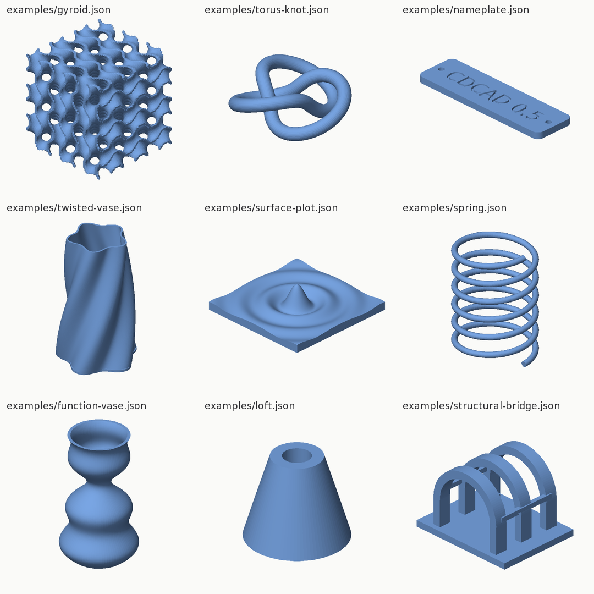

# CDCAD

> Installing CDCAD from pip
```sh
pip install cdcad
```

CDCAD is a small command-line tool that builds STL (and 3MF) files from numbers, formulas, drawings and images. You describe the part in a JSON file, an SVG, a grayscale picture or a bit of Python, and it writes the mesh and tells you whether that mesh is a closed solid. The name is short for CLI-driven CAD.

```sh
cdcad make box --size 40 25 6 -o block.stl
cdcad build examples/spring.json --out-dir models     # a formula in, a spring out
cdcad render examples/gyroid.json -o gyroid.png       # look at it first, no viewer needed
```



## What it's for

Automating the dull part of making models. In practice that's parts that come out of maths (a vase whose radius follows a sine wave, a spring, a gyroid, holes on a computed circle, a plot of z = f(x, y)), parts you want to regenerate with a different number, and images you want to turn into relief or outlines you want to extrude.

You can type all of it by hand. For a one-off that works, but it's a lot of typing, and the commands are really there so that scripts, Makefiles and other programs can do the typing for you. That includes coding assistants: every command speaks JSON and explains its errors, so an assistant can write a recipe, look at a render of it and fix it.

I built it to kinda just accelerate making STLs for school projects. That's it. I write a function - it makes a STL.

## What it isn't

It isn't a CAD system and doesn't try to compete with one. If you want parametric CAD in Python, look at CadQuery or build123d. CDCAD has no sketch constraints, no STEP or BREP, no GUI, and no fillets or chamfers on solids. It works on triangle meshes, and a curve is a polygon with as many sides as you ask for.

It doesn't design anything for you either. There's no machine learning in it, no network access and no "describe what you want" mode. It does what the recipe says.

It doesn't judge printability. It checks that a mesh is watertight and has a positive volume, and it can check sizes, volumes, masses and the fit on a build plate if you ask. Overhangs, wall thickness and supports are for you to look at.

## Install

You need Python 3.11 or newer. Install it from PyPI, ideally inside a virtualenv:

```sh
python -m pip install cdcad
cdcad --version
```

The dependencies (numpy, scipy, trimesh, shapely, manifold3d and a few more) come along automatically. For the development version, install from GitHub instead: `python -m pip install git+https://github.com/MilkmanAbi/CDCAD.git`. To work on it, clone the repo and run `python -m pip install -e ".[test]"`.

## Things to try

The examples are in the repo, so run these from a clone.

By hand:

```sh
cdcad make box --size 40 25 6 -o block.stl
cdcad inspect block.stl --density 1.24
cdcad extrude --path-data "M0 0 H40 V25 H0 Z M8 8 H16 V16 H8 Z" --height 6 -o plate.stl
```

Every command prints one JSON object on stdout (put `--pretty` before the command to indent it). The report for the box says `"is_volume": true`, `"volume": 6000.0` and, with the density of PLA, `"mass_g": 7.44`. The plate is a 40 x 25 rectangle with an 8 mm square hole, because a contour inside another one counts as a hole.

With a recipe. This is a JSON file of named profiles and solids, where any value starting with `=` is arithmetic on the parameters:

```json
{
  "version": 1,
  "params": {"w": 60, "d": 40, "h": 6},
  "profiles": {
    "outline": {"op": "rectangle", "size": ["=w", "=d"], "radius": 3},
    "hole": {"op": "circle", "radius": 4, "center": ["=w/4", 0]},
    "plate": {"op": "difference", "inputs": ["outline", "hole"]}
  },
  "solids": {"part": {"op": "extrude", "profile": "plate", "height": "=h"}},
  "exports": [{"solid": "part", "path": "part.stl"}],
  "checks": [{"solid": "part", "size_z": {"approx": "=h"}, "fits": [220, 220, 250]}]
}
```

```sh
cdcad validate recipe.json
cdcad render recipe.json -o plate.png
cdcad build recipe.json --out-dir out
cdcad build recipe.json --out-dir out --set w=90 --set h=10 --force
```

The first build makes a 60 x 40 x 6 plate, the second a 90 x 40 x 10 one. `checks` are assertions about the result: a failing one stops the build before anything is written. Expressions have the usual maths functions (`sin`, `atan2`, `sqrt`, `hypot`, `exp`, `log`, `min`, `clamp`, `smoothstep` and more), comparisons and `a if c else b`, and nothing else: a recipe has no way to reach Python.

`cdcad describe` lists every operation, and `cdcad describe sweep` (or any other) shows its properties with a working example.

## Shapes from formulas

These need no Python, just a recipe:

- `function` is the area under y = f(x), or between x = f(y) and the axis, which `revolve` turns into a vase or a knob. `examples/function-vase.json` is the vase below without a script.
- `curve` is a closed outline (x(t), y(t)): gears, cams, roses, lobed shapes.
- `graph` is the solid under z = f(x, y). `examples/surface-plot.json` prints sin(r)/r.
- `implicit` is the solid where f(x, y, z) < 0, which gives spheres, blobs (`smin` blends them) and gyroids. `examples/gyroid.json` is a block of gyroid lattice.
- `sweep` runs a profile along a 3D path or a parametric curve, for springs, threads, pipes and knots. `examples/spring.json` and `examples/torus-knot.json` use it.
- `extrude` can `twist` and `scale` as it rises (`examples/twisted-vase.json`), and `text` makes labels from a bundled font (`examples/nameplate.json`).

## From Python

`examples/vase.py` samples a radius formula every 1.5 mm and revolves the outline. `examples/ripple.py` saves a numpy height map and turns it into a relief. `examples/design-sweep.py` builds one plate at three thicknesses and checks each volume against the formula. The recipe builder writes the same JSON recipes with less typing:

```python
from cdcad import Recipe

r = Recipe(params={"w": 60, "d": 40, "h": 6}, density=1.24)
p = r.p
plate = r.rectangle([p.w, p.d], radius=3) - r.circle(4, center=[p.w/4, 0])
part = plate.extrude(p.h).rename("plate")
r.export(part, "plate.stl")
report = r.build("out")            # the same report as cdcad build
mesh = r.mesh(part, w=90)          # a trimesh mesh, with an override
r.render(part, "plate.png")
```

`examples/wheel.py` builds a spoked wheel with 3, 5 and 8 spokes this way and prints each one's mass.

## From an image or a drawing

```sh
cdcad build examples/heightfield.json --out-dir models
cdcad extrude examples/outline.svg --select plate --height 3 -o plate.stl
```

A grayscale image becomes a relief. Black is the base thickness and white is the base plus the height you set, and the picture keeps the orientation you see on screen. 16-bit PNGs keep their precision, so a slow gradient doesn't show steps. SVG and DXF outlines get extruded. From an SVG only filled shapes are read, so strokes and text are ignored. CDCAD doesn't trace photos into outlines or guess depth from them.

## Projects

For something made of several parts there are project folders. Each part is its own small recipe, and the project holds the shared parameters, layers, placements and named assemblies. Builds are incremental: in the arch demo, changing the span rebuilds the two outputs that depend on it and leaves the other three alone.

```sh
cdcad project init demo --template arch-demo
cdcad project build demo
cdcad project set demo /params/span 70
cdcad project build demo          # rebuilds arch and demo, skips the rest
cdcad project restore demo last   # takes that edit back
```

Every edit saves a snapshot, so `project history` lists them and `project restore` goes back to one. [PROJECTS.md](https://github.com/MilkmanAbi/CDCAD/blob/main/PROJECTS.md) has the rest.

## From scripts and coding assistants

Commands exit 0 on success, or 2 with a JSON error on stderr that usually carries a `hint` ("Did you mean 'cylinder'?"), so any language can drive it. A recipe can come in on stdin (`cdcad build -`). Each `cdcad` call imports numpy, scipy and the rest, which takes a few seconds on Windows, so for many models use the Python API, or `cdcad serve`, which keeps one process running and takes one JSON request per line. See [SCRIPTING.md](https://github.com/MilkmanAbi/CDCAD/blob/main/SCRIPTING.md).

For assistants, `cdcad guide` prints a one-page manual, and the loop that works is: write the recipe, `validate`, `render` and look at the picture, then `build`. [AGENTS.md](https://github.com/MilkmanAbi/CDCAD/blob/main/AGENTS.md) spells it out. `cdcad mcp` runs a Model Context Protocol server, so an MCP client can call CDCAD as tools and see the renders; register it as a stdio server with command `cdcad` and argument `mcp`.

## Limits

- Booleans need closed solids. CDCAD won't write a mesh that isn't one unless you pass `--allow-open`.
- Curves are polygons, 96 sides by default. Raise `segments` where it shows.
- `loft` and `sweep` can self-intersect when the shape changes a lot or a path bends tighter than the profile, and nothing checks for it beyond the closed-solid test.
- `implicit` meshes on a grid, so features smaller than its `resolution` disappear.
- STL has no units, so everything is written in millimetres. 3MF records millimetres. `--units` only changes how you enter dimensions.
- DXF input handles lines, arcs, circles, ellipses, splines and polylines in the XY plane. Open or dangling contours are rejected rather than repaired.
- The tests run in CI on Linux, macOS (Intel and Apple Silicon) and Windows, with Python 3.11 and 3.13. [TEST_RESULTS.md](https://github.com/MilkmanAbi/CDCAD/blob/main/TEST_RESULTS.md) has the notes from local runs.
- A valid mesh isn't a good print. The checks are about the mesh, not about any printer.

## More

[REFERENCE.md](https://github.com/MilkmanAbi/CDCAD/blob/main/REFERENCE.md) covers every command, flag and file format. `cdcad describe`, `cdcad schema` and `cdcad capabilities` print the supported operations straight from the code. Changes are in [CHANGELOG.md](https://github.com/MilkmanAbi/CDCAD/blob/main/CHANGELOG.md). Tests are `python -m pytest` and take a couple of minutes.

CDCAD is licensed under the GPL v3. See [LICENSE](https://github.com/MilkmanAbi/CDCAD/blob/main/LICENSE). The bundled DejaVu Sans font (a subset, in `cdcad/fonts`) has its own permissive licence next to it.
